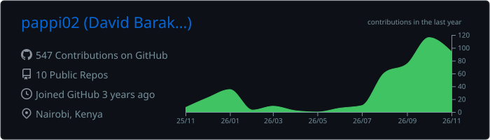
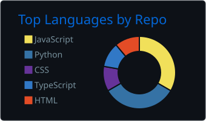
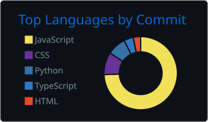
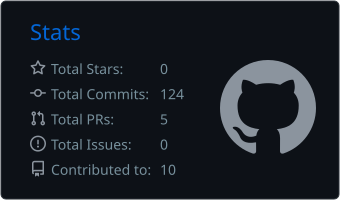
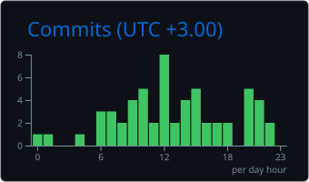

  

  

  
  
  

---

### 👨🏾‍💻 About me

- 🎓 **BSc Computer Technology**, Maseno University (graduated Nov 2026)
- 🌐 **Network Technician (part-time)**, Artax Networks, 2023 – 2026: Wi-Fi, routers and network setup and troubleshooting
- 🖥️ **IT Support attachment**, Kibabii University, 2025: helpdesk work and ERP user support
- 🛡️ **Cisco Ethical Hacker** certified: access control, firewalls, vulnerability assessment
- 🚀 **Freelance developer**: sites and systems for The Hideaway Resort & Spa, Elite Masquerade, My Sweet Kitty
- 📍 Nairobi, Kenya · available for IT Support / Systems roles

### 🧰 Toolbox

**IT & infrastructure**

  

**Development & data**

  

| Area | Skills |
|---|---|
| 🔧 IT Support | Hardware and software troubleshooting · PC and printer setup · Windows · user onboarding and offboarding |
| 🌐 Networking | TCP/IP · LAN/WAN · Wi-Fi and router configuration · DHCP · Cisco Packet Tracer |
| 🗂️ ERP & Systems | ERP user support · user accounts and access rights · role-based permissions |
| 🛡️ Security | Cisco Ethical Hacker · firewalls · vulnerability assessment · 2FA · secure credential handling |
| 💻 Development | Python/Django · JavaScript/React · Next.js · SQL databases · REST APIs |

### 📊 GitHub dashboard

  

  
  

  
  

  

### 📂 Featured projects

| Project | What it is | Stack |
|---|---|---|
| [UniStay](https://github.com/pappi02/unistay) | Hostel booking system with an admin panel, occupancy reports and double-booking prevention | Django |
| [CUTS](https://github.com/pappi02/CUTS) | Campus Unified Ticketing System for Maseno University | Django REST · React · Docker |
| [iVote Systems](https://github.com/pappi02/Online-Voting-System) | Secure online voting for institutional elections | Django · React |
| [TextVerity](https://github.com/pappi02/Turnitinworks) | Academic submission and similarity-report platform | Django · React |
| [Mary Nyangweso Foundation](https://github.com/pappi02/NGO-WEBSITE) | NGO website | React · Vite |
| [CampusConnect](https://github.com/pappi02/campusconnect) | Peer-to-peer campus marketplace | React · Node |

### 🐍 Contribution activity

<picture>
  <source media="(prefers-color-scheme: dark)" srcset="https://raw.githubusercontent.com/pappi02/pappi02/output/snake-dark.svg" />
  <source media="(prefers-color-scheme: light)" srcset="https://raw.githubusercontent.com/pappi02/pappi02/output/snake-light.svg" />
  
</picture>

  

