<a href="https://david-baraka.vercel.app">
  <picture>
    <source media="(prefers-color-scheme: dark)" srcset="./assets/header-dark.svg" />
    <source media="(prefers-color-scheme: light)" srcset="./assets/header-light.svg" />
    
  </picture>
</a>

  &nbsp;
  &nbsp;
  &nbsp;
  

 

I keep **systems, networks and people running**: fixing the laptop that won't connect, configuring the office Wi-Fi, managing who can access what in the ERP, and building the software organisations depend on. I graduated with a **BSc in Computer Technology** from Maseno University and hold the **Cisco Ethical Hacker** certification.

 

## Experience

| | Role | Where | When |
|:-:|---|---|---|
| 🌐 | **Network Technician** (part-time) | Artax Networks | 2023 – 2026 |
| 🖥️ | **IT Support**, industrial attachment | Kibabii University | May – Jul 2025 |
| 🚀 | **Freelance Web Developer & IT Consultant** | Independent | 2024 – now |
| 🎓 | **BSc Computer Technology** | Maseno University | Graduated Nov 2026 |

<b>What that work involved</b>

 

- **Networking:** installed and configured Wi-Fi and routers, set up IP and DHCP, and troubleshot connectivity on client sites
- **IT support:** helpdesk support for staff and students across hardware, software and network problems; set up PCs and printers
- **ERP:** supported users of the university ERP, fixed account and access problems, and escalated faults to the ICT team
- **Client systems:** shipped and support sites and booking systems for The Hideaway Resort & Spa, Elite Masquerade and My Sweet Kitty, including hosting, DNS and credentials

 

## Toolbox

<table>
  <tr>
    <td width="50%" valign="top">
      <b>IT &amp; infrastructure</b>  
        
      Helpdesk & troubleshooting · Windows deployment · Wi-Fi, routers, LAN/WAN, TCP/IP, DHCP · Cisco Packet Tracer · ERP user and access admin · Backups · 2FA, firewalls, vulnerability assessment
    </td>
    <td width="50%" valign="top">
      <b>Software &amp; data</b>  
        
      Python/Django · TypeScript/React · Next.js · Tailwind · PostgreSQL & MySQL · REST APIs · Git & GitHub Actions · Vercel · Arduino & Raspberry Pi
    </td>
  </tr>
</table>

 

## Dashboard

  <picture>
    <source media="(prefers-color-scheme: dark)" srcset="./assets/stats-dark.svg" />
    <source media="(prefers-color-scheme: light)" srcset="./assets/stats-light.svg" />
    
  </picture>
  <picture>
    <source media="(prefers-color-scheme: dark)" srcset="./assets/languages-dark.svg" />
    <source media="(prefers-color-scheme: light)" srcset="./assets/languages-light.svg" />
    
  </picture>

These cards are generated daily from live GitHub data by <a href="./scripts/build_dashboard.py">a small Python script</a> run by <a href="./.github/workflows/dashboard.yml">GitHub Actions</a>.

 

## Selected work

<table>
  <tr>
    <td width="50%" valign="top">
      <a href="https://github.com/pappi02/executive-hideaway"><b>The Hideaway Resort &amp; Spa</b></a> 
      Client · Booking site and admin with 2FA, backups and a menu system  
        
    </td>
    <td width="50%" valign="top">
      <a href="https://github.com/pappi02/unistay"><b>UniStay</b></a> 
      Hostel booking with an admin panel, occupancy reports and double-booking prevention  
       
    </td>
  </tr>
  <tr>
    <td width="50%" valign="top">
      <a href="https://github.com/pappi02/Quicklend"><b>QuickLend</b></a> 
      Loan management with role-based access for borrowers, officers and admins, plus two-factor login  
       
    </td>
    <td width="50%" valign="top">
      <a href="https://github.com/pappi02/CUTS"><b>CUTS</b></a> 
      Campus Unified Ticketing System for Maseno University  
        
    </td>
  </tr>
  <tr>
    <td width="50%" valign="top">
      <a href="https://github.com/pappi02/Online-Voting-System"><b>iVote Systems</b></a> 
      Secure online voting for institutional elections, with audit logging  
       
    </td>
    <td width="50%" valign="top">
      <a href="https://github.com/pappi02/sweet-kitty"><b>My Sweet Kitty</b></a> 
      Client · Online shop with an editorial storefront and admin  
       
    </td>
  </tr>
</table>

 

<picture>
  <source media="(prefers-color-scheme: dark)" srcset="https://raw.githubusercontent.com/pappi02/pappi02/output/snake-dark.svg" />
  <source media="(prefers-color-scheme: light)" srcset="https://raw.githubusercontent.com/pappi02/pappi02/output/snake-light.svg" />
  
</picture>

© 2023–2026 David Baraka Nyongesa · All rights reserved

